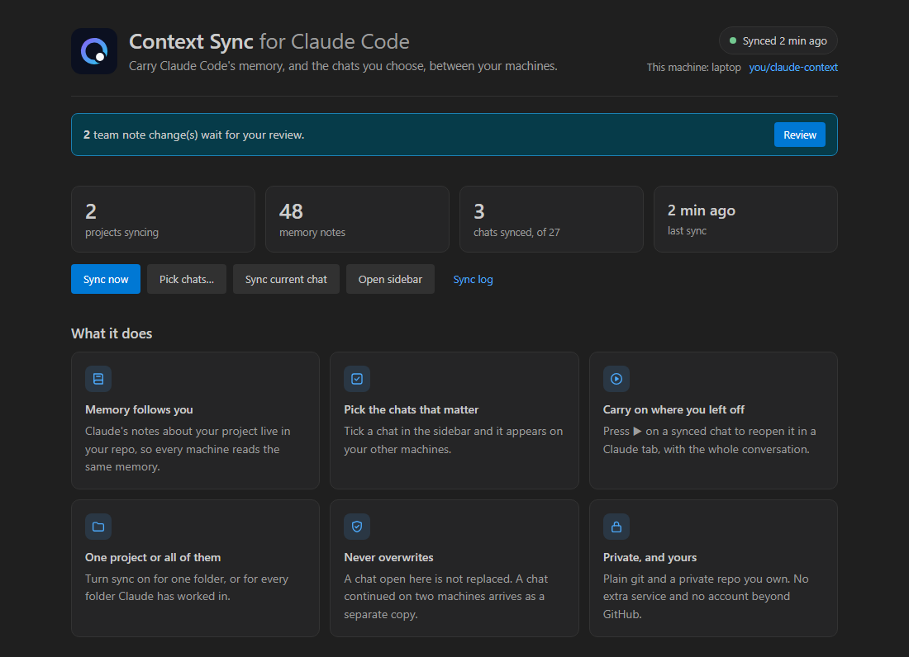
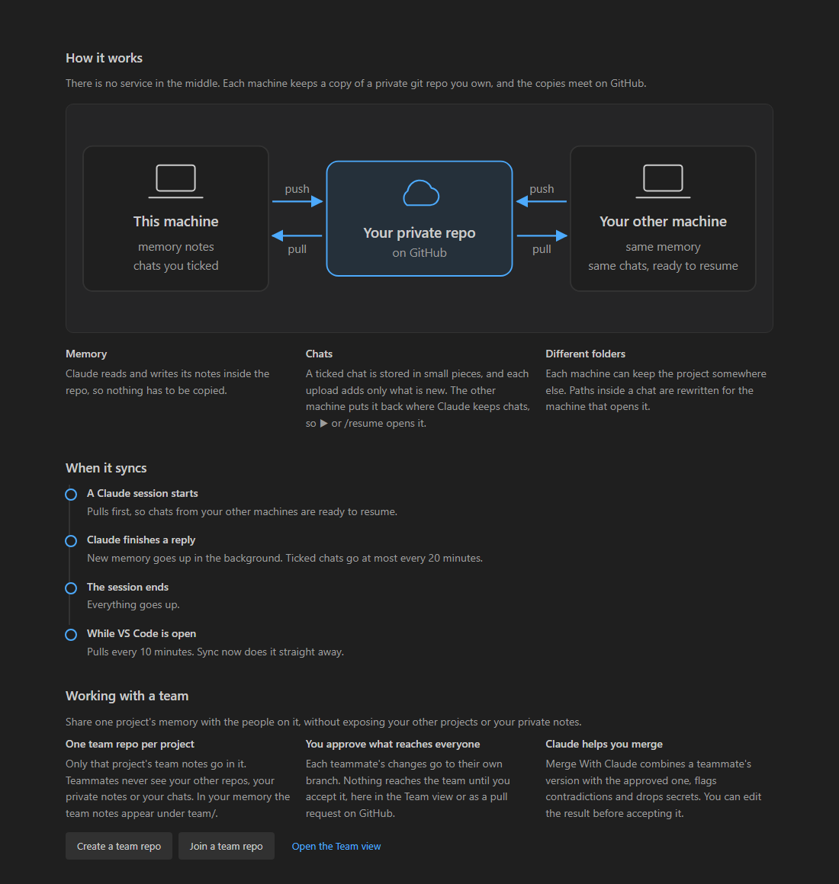

# Context Sync for Claude Code

Claude Code keeps its memory and your chat history on the machine you work on. This
extension keeps both in a **private git repo that you own**, so they follow you to every
machine, and so you can share one project's memory with your team without losing control
of what goes in.



## Use cases

**Work on two machines without starting cold.** Your laptop and your desktop share the
same project memory. Start a task on one, open the other, and Claude already knows the
stack, the deploy steps and the decisions you made yesterday.

**Continue a conversation on another machine.** Tick the chat in the sidebar. On the other
machine it appears in the same list, and ▶ reopens it in a Claude tab with the whole
conversation.

**Keep the chats that matter.** A long design discussion or a tricky debugging session is
saved in your repo, stored in small pieces so it grows cheaply, and can be picked up weeks
later.

**Rebuild a machine in minutes.** After a reinstall, clone your context repo and your
memory and saved chats are back.

**Bring a teammate up to speed.** Share a project's memory through a team repo, and their
Claude starts with what the team already knows: conventions, environments, known traps.

**Keep a wrong note out of everyone's memory.** A teammate's changes go to their own
branch. Nothing reaches the shared memory until you accept it, in VS Code or as a GitHub
pull request. **Merge with Claude** combines their version with yours, flags
contradictions and drops passwords.

**Keep private things private.** Your own notes and chats stay in your personal repo. A
team repo holds only that project's team notes, and teammates never see your other
projects.

## What you get

- **Sidebar.**
  - **Chats:** tick a chat to sync it. ▶ resumes it, ☁↓ pulls it.
  - **Team:** review what teammates propose.
  - **Projects:** turn sync on for one folder or for every folder Claude has worked in.
- **Home page.** Live status, setup steps or quick actions, and how it all works.
- **Status bar.** The last sync time, and how many team changes are waiting for review.
- **Automatic syncing.** Claude Code hooks pull when a session starts and push after each
  reply and at session end. VS Code also pulls every 10 minutes.
- **Nothing is overwritten.**
  - A chat that's open isn't replaced.
  - A chat continued on two machines arrives as a separate copy.
  - A memory note edited on both machines keeps both sets of lines.

## Getting started

You need git, and Node 18+ on your `PATH` (the Claude Code hooks run with it).

**First machine**

1. Open **Context Sync** in the activity bar and click **Set up**.
2. Choose **Create a new context repo**, then accept **Create private GitHub repo**. This
   uses your VS Code GitHub sign-in.
3. Click **Turn on sync for this folder**. Claude's memory for the folder moves into the
   repo.
4. Tick the chats you want everywhere.

**Every other machine**

1. Install the extension, then **Set up** → **Clone my context repo**.
2. Click **Turn on sync for this folder**. When asked which project it is, pick the same
   one.
3. Your synced chats appear under **Synced**. Press ▶ to continue one.

**Sharing a project with your team**

1. In the **Team** view, click **Create a team repo**. A private GitHub repo is created
   for the open project.
2. Add your teammates to it on GitHub with write access.
3. Each teammate clicks **Join a team repo** and pastes its URL.
4. Their changes show up in your Team view. For each one, choose **Compare**, **Merge with
   Claude**, **Accept** or **Reject**.

## How it works



- **Memory.** Claude Code's `autoMemoryDirectory` setting points at your repo, and the old
  memory folder becomes a link to it, so Claude reads and writes there directly.
- **Chats.** A ticked chat is stored as gzip pieces of about 1 MB. An upload adds only
  what's new.
- **Folders.** Each machine can keep the project in a different place. Paths inside a chat
  are rewritten for the machine that opens it.
- **Team repos.** These keep the owner's approved notes on `main`, and each teammate's
  proposals on `people/<name>`. In your memory, the team notes appear in a `team/`
  folder, and their index is copied into your own `MEMORY.md`, so Claude sees both.
- **Merge with Claude.** This runs the Claude Code binary that ships with the Claude Code
  extension. It uses your own login, with no tools enabled and no session saved.
- **No servers.** Everything is plain git between your machines and your GitHub repos.

## Commands

| Command | What it does |
|---|---|
| Context Sync: Open Home | What it does, how it works, live status |
| Context Sync: Sync Now | Push and pull everything now |
| Context Sync: Sync Current Chat | Sync the most recently active chat in this folder |
| Context Sync: Pick Chats to Sync… | Choose chats from a list |
| Context Sync: Turn On Sync for This Project / All Projects | Start syncing memory |
| Context Sync: Create a Team Repo for This Project / Join a Team Repo | Share a project's memory |
| Context Sync: Open Sync Log / Open Context Repo / Show Sync Problems | See what happened |

## Settings

| Setting | Default | |
|---|---|---|
| `claudeContext.repoPath` | `~/claude-context` | Your personal context repo |
| `claudeContext.pullIntervalMinutes` | `10` | Background pull while VS Code is open (0 = off) |
| `claudeContext.nodePath` | VS Code's runtime | Node used to run the sync tool |
| `claudeContext.claudePath` | the Claude Code extension's binary | Claude used by Merge with Claude |
| `claudeContext.mergeModel` | `sonnet` | Model used by Merge with Claude |

## Privacy

- **Keep your context repos private.** Memory notes can contain anything you told Claude,
  and chats contain full tool output.
- **No telemetry.** The extension talks to nothing except git remotes you configure, the
  GitHub API when you ask it to create a repo, and the local Claude Code binary when you
  use Merge with Claude.
- **Your sign-in stays with you.** The GitHub sign-in is VS Code's own. The extension
  passes the token to git only when you agree to it.

## Good to know

- **The free plan can't lock `main`.** On GitHub's free plan, a private repo can't stop
  someone with write access from pushing to it. The extension never does that for a
  teammate. To enforce it, protect `main` (GitHub Pro or Team), or give teammates read-only
  access.
- **Screenshots inflate chats.** They barely compress, so such a chat costs nearly its full
  size in the repo.
- **One chat continued on two machines at once** gives you two chats, not a merge.
- **It depends on Claude Code's on-disk layout:** `~/.claude/projects`, transcripts,
  `autoMemoryDirectory` and hooks. If Claude Code changes these, an update may be needed.

Context Sync is an independent project, not affiliated with or endorsed by Anthropic.
Claude and Claude Code are trademarks of Anthropic.

## Development

```
extension.js        the extension: views, commands, setup and review flows
home.js             the Home page (a webview in the editor's theme)
engine/ccsync.js    the sync tool, copied into every context repo
test/               unit, two-machine and team tests (npm test, needs git)
```

`npm run package` builds the `.vsix`.
